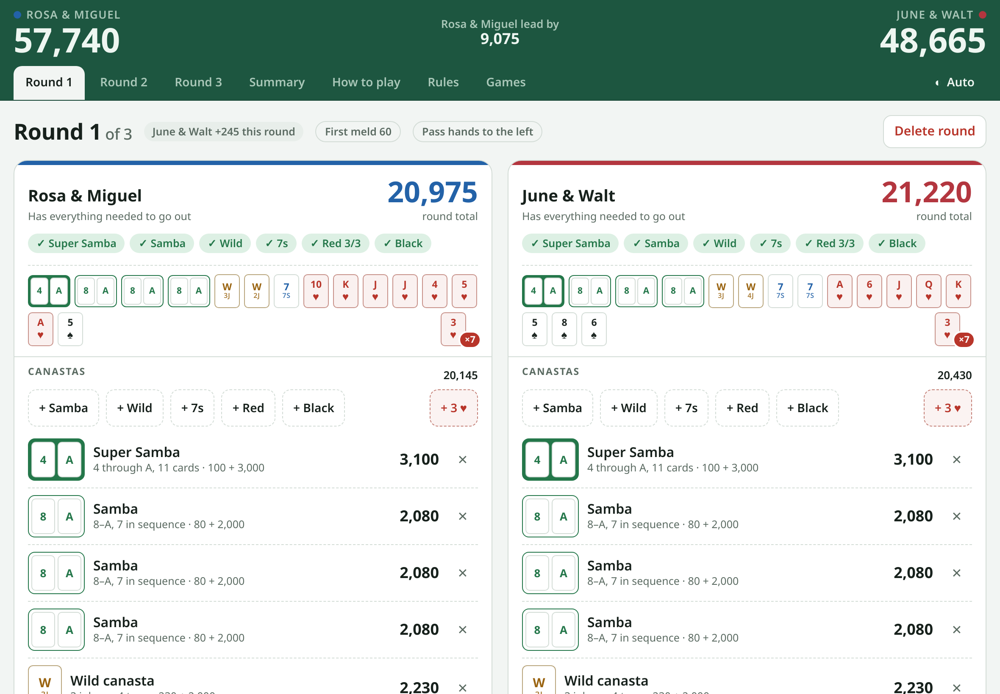
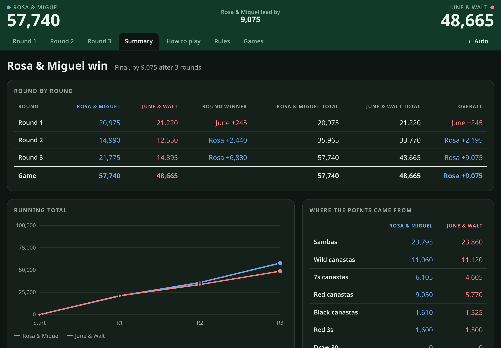
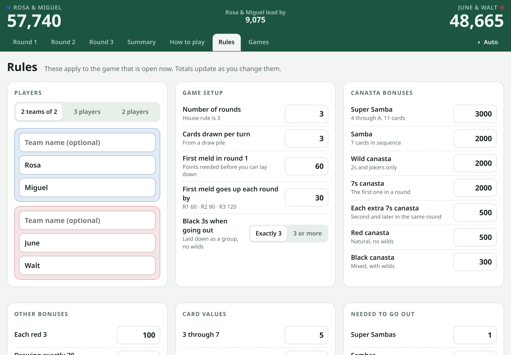
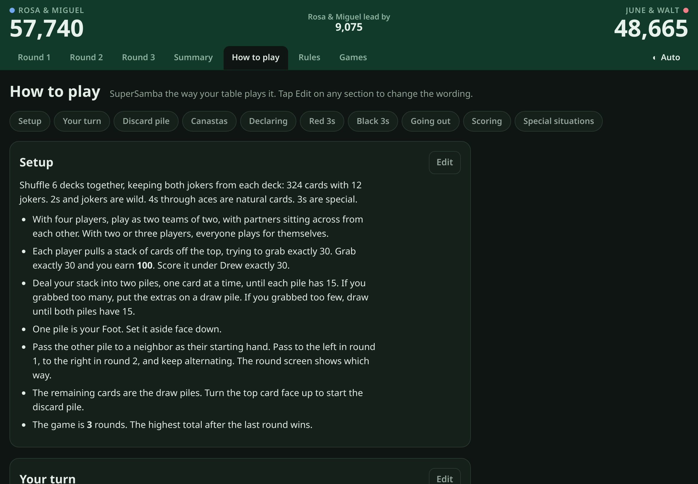
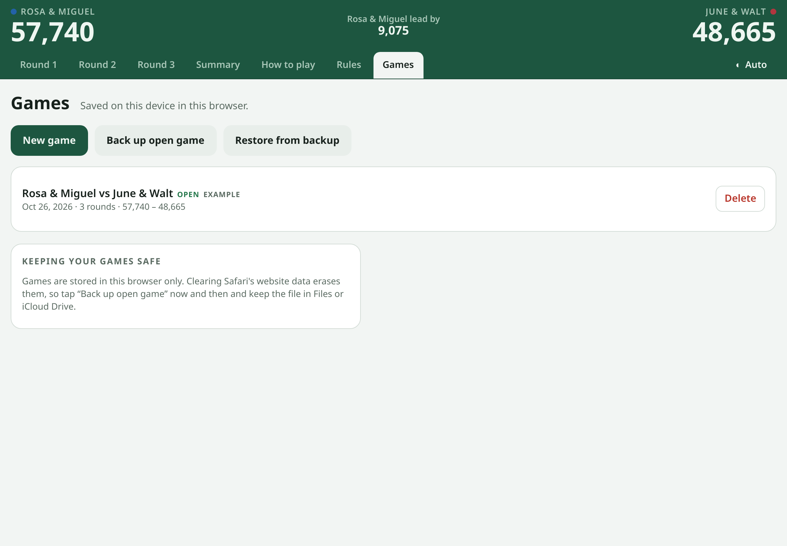
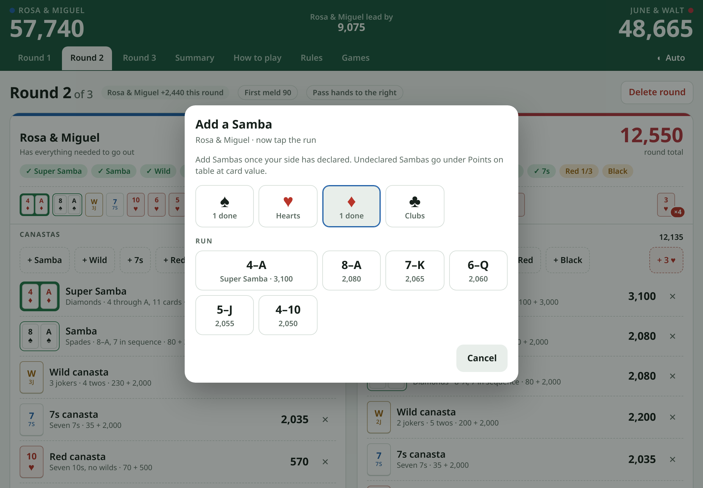
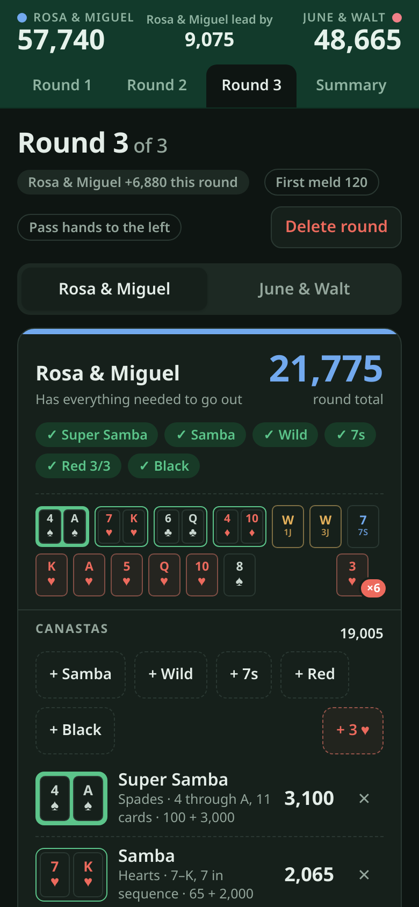
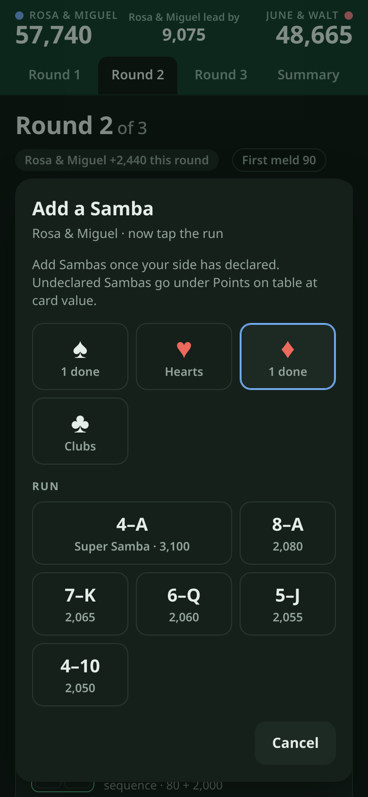

# SuperSamba Scorekeeper

A scorekeeper for SuperSamba, the Samba card game played with a Super Samba (4 through ace), wild canastas and 7s canastas.

**Open it:** https://0x54c3.github.io/SuperSamba_Scorekeeper/

## Screenshots

<table>
<tr>
<td width="50%"></td>
<td width="50%"></td>
</tr>
<tr>
<td><em>Summary, dark theme</em></td>
<td><em>Rules</em></td>
</tr>
<tr>
<td></td>
<td></td>
</tr>
<tr>
<td><em>How to play, dark theme</em></td>
<td><em>Games, back up and restore</em></td>
</tr>
<tr>
<td colspan="2"></td>
</tr>
<tr>
<td colspan="2"><em>Adding a Samba: pick the suit, then the run</em></td>
</tr>
</table>

 <em>On a phone: one side at a time, and the Samba picker</em>

## Use it on Apple devices

The app runs in Safari and can be installed like a regular app. Installing it is what makes it work offline, so do this rather than bookmarking the link.

### iPad or iPhone

1. Open https://0x54c3.github.io/SuperSamba_Scorekeeper/ in **Safari**. Other browsers on iOS cannot install it properly.
2. Tap the **Share** button (the square with an arrow). On iPad it is at the top right of the address bar, on iPhone at the bottom of the screen.
3. Scroll down the share sheet and tap **Add to Home Screen**, then **Add**.
4. Open the app once from the new **SuperSamba** icon while still online. From then on it works with no internet and opens full screen without Safari's address bar.

### Mac

1. Open the link in **Safari** (macOS Sonoma or later).
2. Choose **File → Add to Dock**, then click **Add**.
3. Open it once from the Dock while online. It then runs as its own window and works offline.

### Keep in mind

- Scores are saved on that device only, not on GitHub and not shared between devices. Each iPad, iPhone or Mac keeps its own games.
- Use **Games → Back up open game** now and then and keep the file somewhere safe. **Games → Restore from backup** loads it again, on the same device or a different one.
- Removing the icon from the home screen or Dock deletes the saved games with it. Back up first.
- Updates are automatic. Whenever the app is opened with internet, it loads the newest version from GitHub and saves it for offline use.

## Run it from a download instead

On a Mac or PC you can also run the app without the link. On the GitHub page, click **Code → Download ZIP**, unzip it and double-click `index.html`. It opens in any browser and works offline, but it will not update itself and cannot be installed as an app. Replace the files with a fresh download to get a new version.

This does not work well on iPad or iPhone. Safari cannot install a home-screen app from a local file and offline saving is unreliable there, so use the link and **Add to Home Screen** instead.

## What's here

| File | What it is |
| --- | --- |
| `index.html` | The whole app |
| `sw.js` | Saves the app on the device so it works offline |
| `manifest.webmanifest` | Name and icon for the home screen |
| `icon-*.png` | App icons |
| `screenshots/`, `tools/` | README images and the script that makes them. Not part of the app. |

## Updating

Upload new versions of these files over the old ones. Devices pick up the new version the next time the app is opened online.
